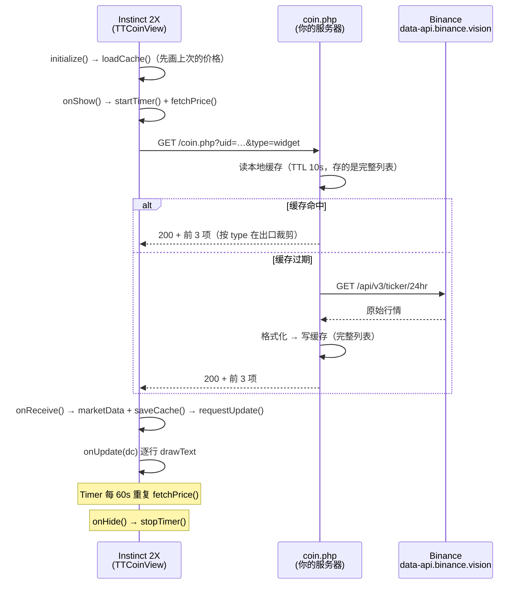

# TTCoin

> 在 Garmin Instinct 2X 上随手看一眼币价。一个只有 100 多行的 Connect IQ Widget。

> **注**：本目录是 Widget 形态的独立版本（Watch App 版在 `TTCoin_APP`）。
> 相对早期备份的改动：接口改到 `/ttcoin/api/coin.php`（地址是 `source/TTCoinView.mc` 里的
> `PRICE_API` 常量），每行行情右侧增加 24h 涨跌方向
> 箭头（手绘三角，因为内置字体没有 ↑/↓/▲/▼ 字形），缓存结构升级到 v3；
> 请求带上设备唯一标识 `?uid=`（`uniqueIdentifier`，与 Watch App 版一致），
> 并额外携带形态标记 `?type=widget`（Watch App 版发 `type=app`），服务端日志据此区分两种形态。


```
        TT
      - Coin -
  BTC: 75701.02
  ETH: 2235.51
  DOGE: 0.0716
```

---

## 目录

- [这是什么](#这是什么)
- [功能特性](#功能特性)
- [工作原理](#工作原理)
- [目录结构](#目录结构)
- [环境要求](#环境要求)
- [快速开始](#快速开始)
- [后端部署](#后端部署)
- [接口约定](#接口约定)
- [自定义配置](#自定义配置)
- [已知限制](#已知限制)
- [常见问题](#常见问题)
- [参与贡献](#参与贡献)
- [免责声明](#免责声明)
- [English](#english)

---

## 这是什么

`TTCoin` 是一个 Garmin Connect IQ **Widget**（小工具，不是表盘）。抬腕切到小工具页，就能看到 BTC / ETH / DOGE 的实时价格，每分钟自动刷新一次；交易对超过一屏时自动轮播翻页。

行情来自 Binance 公共行情接口，但手表**不直连** Binance，而是经由一个自建的 PHP 中转脚本。这么做有两个原因：

1. Garmin 设备端只支持 HTTPS + 标准 JSON，自己中转一层可以把 Binance 的原始响应裁剪成极小的 3 条记录（约 100 字节），省电省流量；
2. 手表端 TLS 握手机制、DNS 和证书链对目标站点的兼容性有限，中转层可以把不稳定性挡在服务端。

> ⚠️ **重要**：仓库里的 `source/TTCoinView.mc` 中 `PRICE_API` 是占位地址 `https://api.example.com/...`，**直接编译装上不会有数据**。请按 [后端部署](#后端部署) 自建一份，然后改成你自己的地址。

## 功能特性

| 特性          | 说明                                                                                         |
| ----------- | ------------------------------------------------------------------------------------------ |
| 多币种轮播       | 默认每屏 3 行；交易对超过 3 个时每 8 秒自动翻页（不显示页码，副标题只保留状态）。**注意**：Widget 显示几秒就会被系统回收，实际多数场景翻不到第二页，主要靠每次进入刷新 |
| 只取 3 项       | 请求带 `type=widget`，服务端只回候选池前 3 项（`TTCOIN_WIDGET_LIMIT` 可控），响应体积与解析时间都减半                     |
| 自动刷新        | 进入小工具页即刷新，之后 `Timer` 分频轮询：约每 64 秒拉取一次（轮播与抓取共用一个定时器）                                       |
| 离线降级        | 网络失败时显示上次缓存的价格，副标题变为 `- Offline -`                                                         |
| 状态可见        | 六种提示各对应一种情形：`Loading...` / `- Coin -` / `- Cache -` / `- Offline -` / `No Net` / `No Data` |
| 极简协议        | 服务端返回定长 JSON 数组，客户端零解析成本                                                                   |
| 服务端缓存       | 文件缓存（TTL 10s）+ 上游失败时回退旧值，避免手表拿到 5xx                                                        |
| 本地缓存        | 价格写入 `Application.Storage`，冷启动也能秒出数据                                                       |
| 纯 Canvas 绘制 | 不用 layout XML，直接 `drawText` 定位，省内存                                                         |
| 低功耗         | 单页 View，无动画、无后台服务、无 Sensor；`onHide` 立即停表                                                   |

## 工作原理



关键代码路径：

| 文件                     | 职责                                              |
| ---------------------- | ----------------------------------------------- |
| `source/TTCoinApp.mc`  | `AppBase` 入口，`getInitialView()` 返回 `TTCoinView` |
| `source/TTCoinView.mc` | 全部业务：发请求、本地缓存、状态机、定时器、绘制                        |
| `https://github.com/hh1949tt/TTCoin_API/blob/main/coin.php` | 手表调用的主接口，带缓存与降级（服务端独立目录）                 |

## 目录结构

```
TTCoin/
├── manifest.xml                 # Connect IQ 应用清单（id / 类型 / 设备 / 权限 / 语言）
├── monkey.jungle                # 构建配置，指向 manifest.xml
├── source/
│   ├── TTCoinApp.mc             # 应用入口
│   └── TTCoinView.mc            # 视图 + 网络 + 定时器 + 绘制
├── resources/
│   ├── drawables/
│   │   ├── drawables.xml
│   │   └── launcher_icon.png    # 62×62 启动图标
│   └── strings/strings.xml      # AppName = TTCoin
├── docs/
│   └── CODE_REVIEW.md           # 代码审查与改进建议
├── .vscode/launch.json          # Monkey C 调试配置
└── bin/                         # 构建产物（已在 .gitignore 中忽略）
```

## 环境要求

**手表端**

- Garmin Instinct 2X（`instinct2x`）。其他机型需在 `manifest.xml` 的 `<iq:products>` 中追加对应 product id，并自行核对屏幕尺寸与坐标。
- Connect IQ **System API 3.4.0** 及以上（`manifest.xml` 的 `minApiLevel`；设备标识 `uniqueIdentifier` 需要 2.4.1+）。

**开发端**

- [Connect IQ SDK](https://developer.garmin.com/connect-iq/sdk/)（建议 6.x 或更新）
- [Visual Studio Code](https://code.visualstudio.com/) + 官方扩展 **Monkey C**
- 一个 Garmin 开发者签名密钥（`.der`），用于真机安装

**服务端**（详见 [TTCoin_API 的 README](https://github.com/hh1949tt/TTCoin_API#readme)）

- PHP 7.4+，启用 `curl` 与 `json` 扩展；任意支持 HTTPS 的 Web 服务器

## 快速开始

### 1. 克隆并打开

```bash
git clone https://github.com/<your-name>/TTCoin.git
cd TTCoin
code .
```

### 2. 配置接口地址

编辑 `source/TTCoinView.mc` 文件头部的常量：

```monkey-c
const PRICE_API = "https://your-domain.com/coin.php";
```

### 3. 编译

VS Code 中按 `F5`（选择 **Run App**），或在终端手动执行：

```bash
# 生成 .prg（需要开发者密钥，没有 -y 只能编译出模拟器包）
monkeyc -f monkey.jungle -d instinct2x -o bin/TTCoin.prg -y /path/to/developer_key.der

# 安装到已连接的手表
monkeydo bin/TTCoin.prg instinct2x
```

> 密钥在 [Garmin Developer 门户](https://developer.garmin.com/connect-iq/) 的 *Manage Keys* 中生成，生成时导出的 `.der` 文件请勿提交到仓库。

### 4. 在手表上打开

长按 `MENU` → 进入小工具列表 → 找到 **TTCoin Widget**。首次进入会显示 `Loading...`，联网成功后即出现价格。

> 本项目的 `manifest.xml` 用的是**独立的 app id**（`e8dab0f9-…`），与 `TTCoin_APP` 的 `1d087cf1-…` 不同，所以两者可以同时装在同一块表上。如果两个项目共用一个 id，手表会认为它们是同一个应用，后装的把先装的顶掉——详见 `docs/CODE_REVIEW.md` 第十一节。

## 服务端（TTCoin_API）

服务端代码在同级目录 **`https://github.com/hh1949tt/TTCoin_API`**（三个形态共用同一份，本仓库不再内嵌 `api/`）。部署方式、接口约定（`?uid=` / `?type=` 参数、请求日志格式、小数位规则、502 降级行为）见 [TTCoin_API 的 README](https://github.com/hh1949tt/TTCoin_API#readme)。

> **本版只拿 3 项行情。** 请求带 `type=widget`，服务端默认只回候选池前 3 项（`TTCOIN_WIDGET_LIMIT` 开关，见 API README「Widget 只回前 3 项」）——一屏 3 行，多给的也翻不到。缓存里仍是完整列表，Watch App 版照旧拿全部；想让它也拿全部，把开关关掉即可。

## 自定义配置

| 想改什么  | 改哪里                                                                 | 说明                                    |
| ----- | ------------------------------------------------------------------- | ------------------------------------- |
| 接口地址  | `source/TTCoinView.mc:10` `PRICE_API`                               | 必须是 HTTPS                             |
| 轮播间隔  | `source/TTCoinView.mc` `PAGE_MS`                                     | 单位毫秒，默认 8000；每页停留时长                   |
| 抓取周期  | `source/TTCoinView.mc` `FETCH_TICKS`                                 | 每 N 拍抓一次行情（8 拍 × 8s ≈ 64s）            |
| 每屏行数  | `source/TTCoinView.mc` `PAGE_ROWS`                                   | 默认 3；改大要同步缩小 `ROW_PITCH` 或字号，否则会画出八边形 |
| 首行高度  | `source/TTCoinView.mc` `ROW_TOP`                                     | 参考值 75px（176 基准）；再往上第一行的末位小数/箭头会被手电筒灯孔的凸起外圈压住 |
| 行间距   | `source/TTCoinView.mc` `ROW_PITCH`                                   | 参考值 26px；三行字面落在 82..149，铺满灯孔外圈与八边形下斜边之间 |
| 行宽上限  | `source/TTCoinView.mc` `rowLimit()` 里的剖面表 + `MAX_ROW_W`               | **按行**取八边形可用宽度（首行 176，末行约 152），不是固定值；放不下先降字号，再不行才丢箭头 |
| 币种列表  | `TTCoin_API/lib.php` 的 `ttcoin_symbols()`                                   | **只改这一处**，输出顺序 = 数组顺序                |
| 小数位上限 | `TTCoin_API/lib.php` 的 `TTCOIN_MAX_DECIMALS`                                | 默认 4；上游位数超过它才四舍五入                      |
| 缓存时长  | `TTCoin_API/lib.php` 的 `TTCOIN_CACHE_TTL`                                   | 单位秒，默认 10；建议 <= cron 间隔               |
| 数据源   | `TTCoin_API/lib.php` 的 `TTCOIN_API_URL`                                     | 换交易所需同步改 `ttcoin_fetch()` 的解析字段          |
| 应用名   | `resources/strings/strings.xml`                                     | 同时影响启动器显示；叫 `TTCoin Widget` 是为了和 Watch App 版区分 |
| 应用 ID  | `manifest.xml` 的 `iq:application@id`                                | **必须与 `TTCoin_APP` 不同**，否则同表只能存在一个（见常见问题） |
| 支持机型  | `manifest.xml` 的 `<iq:products>`                                    | 需自行适配坐标与字号                            |

## 已知限制

1. **圆屏机型未验证。** 布局按 176×176（Instinct 2X）设计、随屏幕宽高等比例缩放，矩形屏（Instinct 系列、Forerunner 等）可直接用；圆屏（fenix / Epix 等）左上角 `TT` 角标可能贴近弧边，需要额外留白（见 `docs/CODE_REVIEW.md` 第五节）。
2. **Widget 生命周期短。** Connect IQ Widget 显示几秒就会被系统回收，轮播（8 秒/页）多数场景翻不到第二页，真正的刷新时机是每次进入（`onShow`）。若需要手动按键翻页，必须改成 Watch App（Widget 不支持按键输入）。
3. **缓存不区分新旧。** 缓存没有过期判断，隔几天再打开也会先显示旧价，只能靠副标题 `- Cache -` / `- Offline -` 提醒。
4. **箭头只表示方向。** 不显示 24h 涨跌百分比，也没有平盘样式（缺 `change` 时不画箭头）。
5. **单一数据源。** 只接 Binance，未做多源容灾。
6. 更多问题见 [`docs/CODE_REVIEW.md`](docs/CODE_REVIEW.md)。

## 常见问题

**Q: 屏幕上这些提示分别代表什么？**

| 显示            | 含义                 | 下一步                         |
| ------------- | ------------------ | --------------------------- |
| `Loading...`  | 首次进入，还没有任何数据       | 等 2~3 秒；长时间不变看下一问           |
| `- Coin -`    | 实时数据，正常状态          | 无需处理                        |
| `- Cache -`   | 显示的是本地缓存，本次请求还没回来  | 多为刚打开；持续如此说明网络慢             |
| `- Offline -` | 请求失败，正在显示上次成功抓到的价格 | 检查手机网络 / 接口是否可用             |
| `No Net`      | 请求失败，且本地没有任何缓存     | 同上                          |
| `No Data`     | 拿到响应但结构不对          | 检查 `coin.php` 返回是否是 JSON 数组 |

**Q: 一直显示 `Loading...` 或 `No Net`**

按顺序排查：

1. `PRICE_API` 是否为 HTTPS，且域名证书有效（自签证书不行）；
2. `manifest.xml` 是否包含 `Communications` 权限（本仓库已含）；
3. 手机端 Garmin Connect 是否在线——**手表的网络请求实际上经由手机转发**，手机断网则必然失败；
4. 用手机浏览器打开同一个 URL，确认返回的是 JSON 而不是 PHP 源码或 500 页面。

**Q: Watch App 和小工具都装了，但手表上只剩一个**

两个项目的 `manifest.xml` 用了同一个 `iq:application@id`。Connect IQ 是**按 id 认应用**的，同一块表上同一个 id 只能存在一条记录，后装的会把先装的替换掉（`type` 也一起改），所以装完 Widget 再看 App 列表就是空的、或者反过来。

两边的 id 现在已分开：

| 项目 | app id | 类型 | 手表上的入口 |
| --- | --- | --- | --- |
| `TTCoin_APP` | `1d087cf1-27ae-4c64-a653-42e113497d07` | `watch-app` | 应用列表 → **TTCoin** |
| `TTCoin_Widget` | `e8dab0f9-d9a8-4ef5-8bab-fd05bcf135f5` | `widget` | 小工具列表 → **TTCoin Widget** |

已经踩过坑的表，先把旧的 `TTCoin`（旧 id 那条）删掉再分别装两个 `.prg`，否则会多出一条残留。查 id 的命令：

```bash
grep -o 'id="[0-9a-f-]\{36\}"' TTCoin_APP/manifest.xml TTCoin_Widget/manifest.xml
```

**Q: 显示格式错乱，数字挤在一起**

行情行默认用 `FONT_MEDIUM`；`chooseRowFont()` 会在整页最宽的一行放不下时整体降到 `FONT_SMALL`、再降到 `FONT_TINY`，一般不用手动改。若某个币价特别长（比如 `BTC: 756078.49`），可以先确认服务端 `TTCOIN_MAX_DECIMALS` 没有把小位数放大。

**Q: 价格不更新**

Widget 在**每次进入小工具页时**（`onShow`）都会请求一次，之后定时器每约 64 秒再补一次——但 Widget 通常几秒就被系统回收，实际主要靠"进一次刷一次"。想看新价格就退出再进。若长期不变，检查服务端缓存文件（默认 `../cache/coin.json`）的 `filemtime` 是否在更新（服务端缓存 TTL 为 10 秒，也可能正好命中）。

若副标题是 `- Cache -` 或 `- Offline -`，说明显示的是旧数据，不是没更新。

**Q: 能不能改成 A 股 / 汇率 / 黄金？**

可以。改 `TTCoin_API/lib.php` 的 `ttcoin_symbols()`（币种表）与 `ttcoin_fetch()` 的解析字段，保持输出为「`{symbol, base, price}` 对象数组」、`price` 是字符串即可（`symbol` 是显示名，`base` 是原始简称）。**加币种只改服务端这一处**，手表端不用动：

- **3 个以内**：一屏显示完，行为与旧版完全一致；
- **超过 3 个**：自动按页轮播（8 秒/页），副标题只显示状态（`- Coin -` / `- Cache -` / `- Offline -`），不显示页码；
- 币种减少时页码自动回卷，不会画出空页。

## 参与贡献

欢迎 Issue / PR。提交前请确认：

1. 本地能编译通过（`monkeyc -f monkey.jungle -d instinct2x -o bin/TTCoin.prg`）；
2. 不要在代码中提交自己的私有接口地址或密钥；
3. 改动坐标/字号时附上真机截图。

## 免责声明

- 本项目仅用于个人学习与自用，行情数据来自第三方公开接口，**不保证准确性、实时性与可用性**；
- 所有价格仅供参考，**不构成任何投资建议**；
- 请遵守 Binance 及各数据提供方的服务条款，不要高频抓取；
- 因使用本项目产生的任何直接或间接损失，作者不承担责任。

## English

**TTCoin** is a tiny [Garmin Connect IQ](https://developer.garmin.com/connect-iq/) widget for the **Instinct 2X** that shows BTC / ETH / DOGE prices on your wrist.

The watch never talks to Binance directly — it calls a small PHP relay (`coin.php` in the sibling `TTCoin_API` directory) that trims the upstream ticker response down to three records, caches it to a file, and falls back to the last good value when the exchange is unreachable.

**Quick start**

```bash
git clone https://github.com/<your-name>/TTCoin.git
# 1. edit PRICE_API in source/TTCoinView.mc → your own HTTPS endpoint
# 2. build & install
monkeyc -f monkey.jungle -d instinct2x -o bin/TTCoin.prg -y /path/to/developer_key.der
monkeydo bin/TTCoin.prg instinct2x
```

**Backend**: the PHP relay lives in the sibling `TTCoin_API` directory — upload its files to any PHP 7.4+ host with `curl` enabled and HTTPS. See `TTCoin_API/README.md`.

**API contract**: `GET /coin.php` → `[{"symbol":"BTC","base":"BTC","price":"75701.02"}, ...]` in the server's candidate order. `price` is a **string** that follows the upstream's actual decimal places (rounded to 4 only when it has more), so the widget just prints it. Tiny prices arrive scaled with the factor in the display name (`"symbol":"1000*SHIB"`). HTTP 502 on total failure. See the API contract in `TTCoin_API/README.md`.

**Requirements**: Connect IQ SDK, Monkey C VS Code extension, System API 3.4.0+, a Garmin developer key for on-device install.

**Status**: personal hobby project, no support guarantee. Prices are informational only and not investment advice.

## License

以 [PolyForm Noncommercial License 1.0.0](LICENSE) 发布，**仅限非商业用途**。版权归 `TTCoin contributors` 所有。

| 可以 | 不可以 |
| --- | --- |
| 个人学习、研究、自用、改着玩 | **任何商业用途**：卖给客户、随硬件捆绑销售、公司内部业务系统、做成付费服务或订阅 |
| 学校、慈善、政府、公共研究等非商业组织使用 | 拿本项目提供有偿技术支持、代部署或托管服务 |
| 修改、二次开发、分发副本（须保留许可证与版权声明，并注明改动） | 删掉版权与许可证声明后当自己的作品发布 |

一句话区分：**能看到源码 ≠ 可以商用**。这是 source-available，不是 OSI 认可的开源许可证。

需要商用授权，到 [Issues](https://github.com/hh1949tt/TTCoin_Widget/issues) 说明用途即可。软件按"现状"提供，不含任何担保。

This project is licensed under the PolyForm Noncommercial License 1.0.0.
**Commercial use of any kind requires a separate written license.**
