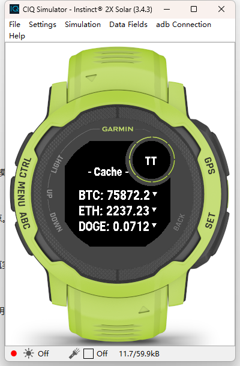

# TTCoin_Widget 发布文档

> Connect IQ **Widget**（`type="widget"`）：在小工具环里滑到就能看 3 行行情 + 涨跌方向箭头，无菜单、无设置页。

| 项目 | 版本 | 发布日期 | 应用 id | 发布形态 | 状态 |
| --- | --- | --- | --- | --- | --- |
| TTCoin_Widget | **1.0.2** | 2026-11-08 | `e8dab0f9-d9a8-4ef5-8bab-fd05bcf135f5` | 侧载 `.prg` / Connect IQ Store（Widgets 分类） | **构建通过 · 模拟器验收通过 · 真机待确认** |

前置依赖：`TTCoin_API` 已上线，且 `TTCOIN_WIDGET_LIMIT` 为开启（默认开）。

---

## 1. 版本与身份

| 项 | 值 |
| --- | --- |
| 版本 | 1.0.2 |
| 类型 | `widget`（小工具环入口，不是应用列表） |
| 手表上的名字 | **TTCoin Widget**（与 APP 的 `TTCoin` 刻意区分） |
| 入口类 | `TTCoinApp`（`AppBase.getInitialView()` → `TTCoinView`） |
| 支持机型 | `instinct2x` |
| 最低 API | 3.4.0 |
| 权限 | `Communications` |
| 语言 | `eng` + `zhs`（无需要翻译的文案，`zhs` 回落基础语言；见 §2.1） |
| 产物 | `bin/TTCoin_Widget.prg`（98,892 字节，2026-11-08 12:20 构建） |
| 接口地址 | `source/TTCoinView.mc` 的 `PRICE_API`（**编译期常量，无属性、无手机设置**） |

**与 APP 版的边界**：id 必须不同（`e8dab0f9-…` vs `1d087cf1-…`），否则同表只能存在一个。本项目是 widget，装它不会出现在应用列表；APP 是 watch-app，装它不会出现在小工具环——**两者不是替代关系**。

## 2. 本次交付内容

| 能力 | 说明 |
| --- | --- |
| 一屏 3 行 | `PAGE_ROWS = 3`；每行 `币种: 价格` + 右侧涨跌箭头 |
| 只拿 3 项 | 请求固定带 `type=widget`，服务端出口裁剪为候选池前 3 项（响应体积与解析时间减半，缓存仍是全量） |
| 行宽按剖面取 | `rowLimit()` 按屏幕 y 取八边形可用宽度（首行 176 → 末行约 152），不是固定 `MAX_ROW_W` |
| 整组居中 | 文本 + 间隙 + 箭头作为一个整体居中，避免首行"有字没箭头" |
| 逐行降字号 | 一行放不下先降该行字体，再不行才丢箭头 |
| 涨跌箭头 | 手绘三角（`fillPolygon`），不依赖字体 |
| 状态可见 | `Loading...` / `- Coin -` / `- Cache -` / `- Offline -` / `No Net` / `No Data`（无页码） |
| 本地缓存 | `Storage` 存上次结果，冷启动先出数据 |

### 2.1 多语言（1.0.1 只动了 manifest）

本 Widget **没有需要翻译的界面文案**：屏幕上只有币种代码、价格（服务端下发的 ASCII 字符串）、
`- Coin -` / `- Cache -` / `No Net` 这类状态词，应用名 `TTCoin Widget` 也是拉丁字符。
因此没有 `resources-zhs/`，只有基础语言 `resources/strings/strings.xml`（`AppName`）。

`manifest.xml` 的 `<iq:languages>` 从 `zhs` 改成 **`eng` + `zhs`**，含义是"两种语言环境都可正常使用"，
中文环境回落到基础语言那份（同一份文案）。这一项是商店元数据，**不影响 `.prg` 的运行时行为**，
产物字节数与 1.0.0 完全一致（98,892）。

状态词为什么不翻译：它们的宽度是按八边形可用宽度逐像素量着定的（`rowLimit()` 的剖面表），
换成中文要重新量版；而且 `- Coin -` / `No Net` 这类缩写在中英环境下都读得懂，收益不抵风险。

## 3. 发布就绪评估

| 维度 | 结论 | 依据 |
| --- | --- | --- |
| 编译 | ✅ | SDK 9.2.0 通过；产物 98,892 字节，晚于 `TTCoinView.mc`（10:50 → 11:33） |
| 布局 | ✅ 模拟器实测通过 | 首行箭头已回归：三行 `BTC/ETH/DOGE` 右侧都有箭头（旧 `MAX_ROW_W=150` 时首行 146+4+7=157 会提前 return，现已改为按 y 取宽 + 整组居中） |
| 与接口契约一致 | ✅ | 只读 `symbol` / `base` / `price` / `change`，字符串直出；模拟器价格与服务端一致 |
| 精简协议对齐 | ✅ | `PAGE_ROWS=3` = 服务端 `TTCOIN_WIDGET_TOP_N=3`，实测正好 3 行 |
| 与 APP 共存 | ✅ | 产物内嵌 UUID 交叉验证 0 命中（脚本见 APP 文档 5.2） |
| 真机 | ✅ 模拟器已验收（2026-11-08，见 §6.1） / ⏳ 真实手表待确认 | 装载成功、`- Cache -` → `- Coin -`、三行箭头齐全 |
| 回滚 | ✅ | 同 id 覆盖安装上一版 |

**判定：可发布使用。** 首行丢箭头这个本轮的核心问题已在模拟器上确认修复。

## 4. 构建

```bash
monkeyc.bat -f monkey.jungle -o bin/TTCoin_Widget.prg \
  -y <path-to-developer_key> \
  -d instinct2x -w -l 2
```

换接口地址：改 `source/TTCoinView.mc` 的 `PRICE_API` 后重编译（本项目没有 `properties.xml`，改不了手机端）。

## 5. 发布步骤

### 5.1 侧载

```bash
monkeydo.bat bin/TTCoin_Widget.prg instinct2x
```

手表：长按 `MENU` → 小工具环 → 滑到 **TTCoin Widget**。

### 5.2 首次安装注意

如果这块表以前装过**同 id** 的旧版本（例如拆分前两个项目共用的 `1d087cf1-…`），先删掉那条残留再装，否则会出现两个入口指向同一 id、或旧条目显示异常。查 id：

```bash
grep -o 'id="[0-9a-f-]\{36\}"' manifest.xml
```

### 5.3 Connect IQ Store（可选）

- 分类是 **Widgets**，与 APP（Apps）是两个独立条目、两套截图、各自审核；
- widget 类型不能提供按键交互，商店描述里不要写"Up/Down 翻页"。

## 6. 发布后验收（真机，4 步）

| # | 操作 | 期望 |
| --- | --- | --- |
| 1 | 小工具环滑到 TTCoin Widget | 3 行 `BTC/ETH/DOGE: 价格`，**每行右侧都有箭头**（含第一行） |
| 2 | 看副标题 | 先 `- Cache -`，正常应在秒级变 `- Coin -`（本轮修复目标：不再长时间停在 `- Cache -`） |
| 3 | 退出再进 | 立刻有数据（缓存），随后刷新，不出现空白 |
| 4 | 服务端日志 | 出现 `widget` + `hit`/`async` + 第 6 列 `top3` |

验收重点是**首行箭头**与 **`- Cache -` 停留时长**这两处——它们正是本轮改动的对象，也可能带来回归（首行变窄、箭头被挤掉）。

### 6.1 模拟器验收记录（2026-11-08 12:05 前后）

环境：Connect IQ SDK **9.2.0**，模拟器设备 `Instinct® 2X Solar (3.4.3)`，`monkeydo TTCoin_Widget.prg instinct2x`（退出码 0）。

| 观察点 | 实测结果 |
| --- | --- |
| 首帧 | `- Cache -` · `BTC: 75872.2 ▼` / `ETH: 2237.23 ▼` / `DOGE: 0.0712 ▼` —— **三行都有箭头，含第一行** |
| 约 10s 后 | `- Coin -` · `BTC: 75925.21 ▲` / `ETH: 2238.48 ▼` / `DOGE: 0.0714 ▼` —— 价格已刷新，且箭头方向随涨跌各自变化 |
| 行宽 | `BTC: 75925.21 ▲` 这种 8 字符价格 + 箭头仍完整落在八边形内，末位未被切 |
| 条数 | 正好 3 行，与服务端 `top3` 对齐 |
| 服务端对照 | 同时段 `?type=widget` 返回 `BTC 75882 / ETH 2237.49 / DOGE 0.0713`，量级与小数位一致 |

| 截图 | 说明 |
| --- | --- |
|  | 进入时 `- Cache -`，三行箭头齐全 |
|  | 切到 `- Coin -`，价格刷新、箭头方向分化 |

## 7. 回滚

1. 同 id 覆盖安装上一版 `.prg`；
2. 无法启动则删掉小工具条目再装；
3. 缓存 key 与 APP 不同（对方是 `ttcoin_cache_v3`），两者的 `Storage` 也按 app id 隔离，回滚互不影响。

## 8. 已知限制（1.0.1 范围外）

- **Widget 生命周期短**：显示几秒被系统回收，8 秒/页的轮播多数场景翻不到第二页，实际靠"进一次刷一次"；
- **不支持按键**：不能手动翻页（要翻页请用 APP 版）；
- **无设置页、无属性**：币种、地址都不可配，换地址必须改源码重编译；
- **只显示 3 项**：由服务端 `TTCOIN_WIDGET_TOP_N` 决定，且一屏也只有 3 行；
- **圆屏未验证**：布局按 176×176 矩形屏设计，fenix/Epix 等圆屏需重测边角；
- **无页码**：多页时只靠轮播，看不出当前第几页。

## 9. 风险登记

| 编号 | 风险 | 影响 | 现状与缓解 |
| --- | --- | --- | --- |
| R1 | 首行箭头修复的回归风险 | 调宽后可能挤掉箭头或截断末位小数 | 模拟器实测三行箭头齐全、末位完整；真机仍需看一眼 |
| R2 | `PRICE_API` 硬编码 | 换服务端必须重编译、重装 | 属设计选择（widget 无设置页）；文档已明示；仓库内为占位地址，上线前必须改成自己的 |
| R3 | 与服务端条数不一致 | 改 `TOP_N` 后 widget 仍只画 3 行 | 只浪费流量，不报错；改条数时两边一起看 |
| R4 | 服务端开关被关 | widget 拿到全量，解析变慢 | 服务端 `TTCOIN_WIDGET_LIMIT` 默认开；日志第 6 列 `top3` 可验证 |
| R5 | 与 APP 同装时日志混淆 | 同一 uid 两种 type | 按 `type` 列区分，这正是加该参数的原因 |

## 10. 评估发现的文档不一致（已修正）

1. ✅ `README.md`「配置接口地址」原写"编辑 `source/TTCoinView.mc` 第 10 行"，实际 `const PRICE_API` 在第 14 行。已改为按常量名定位，不写行号；
2. ✅ `README.md` 顶部注释原写"接口切换到 `/app/coin.php`"，实际使用 `/ttcoin/api/coin.php`、且在 `PRICE_API` 常量里。已更正；
3. ✅ 功能表「多币种轮播」原与「已知限制」第 2 条自相矛盾，已补注"Widget 常被回收，实际多数翻不到第二页"。

## 11. 变更记录

| 日期 | 版本 | 内容 |
| --- | --- | --- |
| 2026-11-08 | 1.0.0 | 独立 app id（不再与 APP 冲突）；`type=widget` 触发服务端 top3；行宽按八边形剖面逐行取、文本+箭头整组居中；首行下移到 y=75 避开灯孔外圈 |
| 2026-11-08 | 1.0.1 | `manifest` 语言声明改为 `eng` + `zhs`（与 APP 保持一致，说明两种语言环境可用）；无代码与资源改动，产物字节数不变 |
| 2026-11-08 | 1.0.2 | 许可证由 MIT 改为 **PolyForm Noncommercial License 1.0.0**：仅限非商业用途，商用须另行取得书面授权；`LICENSE` 重写并附 `Required Notice`，README 增补「可以 / 不可以」对照；**无代码与资源改动，`.prg` 无需重编** |
